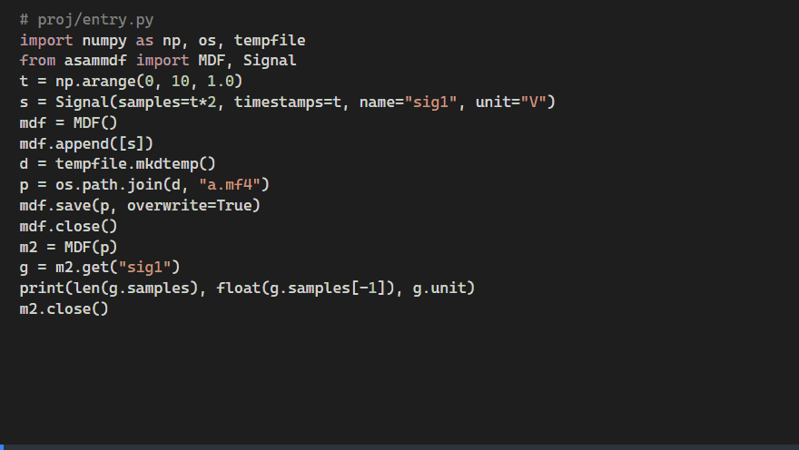

# mcp-pystub

[English](https://github.com/KoyoYeager/mcp-pystub/blob/master/README.md) | 日本語

**依存ライブラリが読み込むだけで、あなたのコードからは一度も使われない重いパッケージを、exe から外す MCP サーバー。**

PyInstaller で作った exe が大きすぎるときに使います。例えば asammdf で MDF ファイルを読み書きするだけのアプリでも、asammdf の GUI 部分が PySide6（Qt）を読み込むため、exe は 252 MB になります。mcp-pystub は依存ライブラリの中まで、アプリが実際には呼ばない部分を探し、スタブ（空の代わりのモジュール）に差し替え、実際に動かして出力が変わらないことを確かめます。差し替えは元に戻せます。



| ライブラリ（使い方の例） | exe（そのまま） | exe（適用後） | 外したもの |
|---|---|---|---|
| asammdf（MDF の読み書き） | 252.0 MB | **38.9 MB** | asammdf.gui → PySide6 |
| networkx | 76.7 MB | **40.8 MB** | scipy・fontTools・pandas |
| tqdm | 47.7 MB | **33.3 MB** | pandas・fontTools・PIL |
| matplotlib | 44.6 MB | **36.0 MB** | pandas・PIL.ImageQt |
| openpyxl | 26.2 MB | **20.3 MB** | PIL |
| Pillow | 25.7 MB | **14.4 MB** | numpy |

PyInstaller（onefile）、Windows 11、Python 3.13。どれも exe の出力が元と一致することを確かめた値です（詳しい条件は[実証データ](https://github.com/KoyoYeager/mcp-pystub/blob/master/docs/results.md)）。

## 使い方

必要なもの: Claude Code などの MCP クライアント、アプリの依存を入れた venv、exe を作る PyInstaller。確かめた環境は Windows 11・Python 3.13 です。

Claude Code に一度登録して、Claude に頼むだけです。

```bash
claude mcp add pystub -- uvx mcp-pystub
```

プロジェクトのフォルダで、こう頼みます。

> mcp-pystub で main.py の exe を小さくして。venv は .venv。動かして確かめていいよ。

venv の場所と、動かしてよいことを添えると、Claude が実際に動かして結果を確かめられます。あとは Claude が、使っていない部分を探し、外して動かし、スタブに差し替えて exe をビルドするところまで進めます。スタブが venv に入るのはビルドの間だけで、終わったら Claude が venv を元に戻します。uv が無い場合や他のクライアント(Claude Desktop など)は、[ツールと設定](https://github.com/KoyoYeager/mcp-pystub/blob/master/docs/tools.md)を見てください。

## 手で外すのと何が違うのか

PyInstaller の `--exclude-module` でもパッケージは外せますが、実行中に一度も import されないと分かっている場合に限ります。見立てを間違えると、exe が `ImportError` で落ちます。めったに通らない処理でだけ落ちて、配った後に気づくこともあります。

- **本当に使っていない部分を見つける**: import されていることと、使われていることは別です。依存ライブラリの奥まで、読み込まれるだけで呼ばれない部分を見分けます（[仕組み](https://github.com/KoyoYeager/mcp-pystub/blob/master/docs/how-it-works.md)）。
- **動かして確かめる**: verify がスタブを差し込んでプログラムを動かし、出力と終了コードが変わらないことを確かめます（プログラムを動かすのは頼んだ時だけ）。
- **原因の分からない落ち方をしない**: 後でアプリが外した部分を使うようになっても、何を外したか・なぜ止まったかを書いたメッセージを出して止まります（そうならない例外は[安全性と制限](https://github.com/KoyoYeager/mcp-pystub/blob/master/docs/safety.md)にまとめています）。
- **元に戻せる**: 元のファイルはバックアップされ、復元のコマンドが出ます。

静的解析だけでは「どんなコードでも壊れない」とは言えないので、提案は候補として出し、最後は動かして確かめる設計です。保証の範囲と制限は[安全性と制限](https://github.com/KoyoYeager/mcp-pystub/blob/master/docs/safety.md)を見てください。

## ドキュメント

- [仕組みと判定](https://github.com/KoyoYeager/mcp-pystub/blob/master/docs/how-it-works.md)（判定の種類、confidence、3 層、実行の記録）
- [安全性と制限](https://github.com/KoyoYeager/mcp-pystub/blob/master/docs/safety.md)（保証の範囲、普段の実行との違いの表、制限の一覧、安全性の方針）
- [ツールと設定](https://github.com/KoyoYeager/mcp-pystub/blob/master/docs/tools.md)（インストール、MCP の設定例、各ツールの引数と出力例）
- [実証データとパフォーマンス](https://github.com/KoyoYeager/mcp-pystub/blob/master/docs/results.md)（測定条件、解析時間・メモリ）
- [判定の仕様](https://github.com/KoyoYeager/mcp-pystub/blob/master/docs/STUB_SAFETY_SPEC.md)
- [変更履歴](https://github.com/KoyoYeager/mcp-pystub/blob/master/CHANGELOG.md)
- [開発](https://github.com/KoyoYeager/mcp-pystub/blob/master/docs/development.md)（テスト、README の GIF の作り方）

## ライセンス / License

MIT
